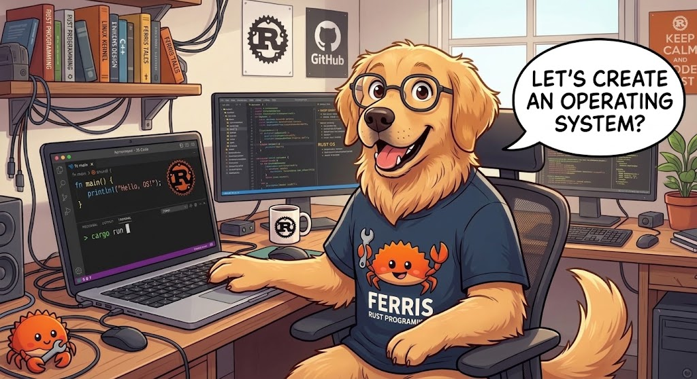

# os-rust

```text
                    #####
                   // : \\
                ..-  --:  -..
           //--/ .:==███==+. \--\\
          //-\ +- ███ █ ███ -+ /-\\
           \\ | ██  @@@@@  ██ | //
            | | @  @     @  @ | |
            | | @██@ ███ @██@ | |
            | | @  @@@@@@   @ | |
           // | ██ @  █  % ██ | \\
          \\.- -- ███ █ ███ -- -.//
           \\--\. -- ███ -- ./--//
                 --. -.- .--
                   \\ : //
                    #####
                                         []
 .o:o.   .s::.       [.o= []  |]   .s:: =++=t
[o   o] [:___  ===== [r   []  |]  [:___  []
[o   o]     :]       []   []  |]      :] []
  o:o   ::__:        []    uu/|]  ::__:   \ut
```



os-rust started as a minimal demonstration of "programming without an
operating system" in Rust: a binary that boots directly via BIOS in a QEMU
virtual machine, writes text to the screen using the VGA video buffer and
reads the keyboard through a hardware interrupt (IRQ1) to feed a minimal
command prompt, with no operating system underneath. From here on, the
project evolves in small steps toward a larger goal: see the Vision section
right below.

If you have never seen how a kernel/bootloader works, also read
[`WALKTHROUGH.md`](./WALKTHROUGH.md): it explains what is happening behind
the boot and the code.

## Vision

The central goal of os-rust is to allow someone to write a program, compile
that program separately from the kernel and run it on os-rust, in user mode,
using a documented programming interface. It is not a general-purpose
kernel: it is an educational kernel that evolves in small milestones, each
one designed to fit in a lesson, always prioritizing the shortest path to
running user programs before features such as a file system or full
multitasking.

## Status

The project documentation is also available in English (see the `ENGLISH VERSION` link at the top of each `.md` file).

**Current version: 0.12.0.** Milestones 0 (boot in VGA text mode, with a
welcome message, scrolling and readable panic handling), 1 (interrupts,
keyboard and command prompt), 2 (debugging infrastructure: serial output
and automated tests inside QEMU), 3 (memory: physical frame allocator,
paging and kernel heap), 4 (protection: own GDT and TSS, handlers for the
main exceptions, double fault with a dedicated stack), 4.1 (new identity:
the project is now called os-rust, with the logo above appearing on screen
at every boot) and 5 (first user program: ring 3, `write` and `exit`
syscalls, static ELF64 loader and the `run hello` command), 6 (programming
interface: keyboard reading and memory for programs, runtime library, and
failure isolation demonstrated with `run eco` and `run falha_memoria`) and
7 (multitasking: several programs at the same time, each in its own memory,
with cooperative and preemptive context switching, demonstrated with `run
ping pong` and `run contador_a contador_b`) and 8 (file system: a ramdisk
and an ATA disk, both FAT16 (read-only in Milestone 8), with `ls`, `cat`, file syscalls and
the execution of a program read from the disk, demonstrated with `run
/disco/bin/visita`) and 9 (RTC driver: the kernel reads the date and time
from the computer's clock, shown by the `data` command and offered to
programs through the `SYS_TIME` syscall, with `run hora`) are completed,
10 (ramdisk writing: creating, appending to and deleting files in `/ram`,
from the prompt and from user programs, with `run gravador` and `run
apagador`) and 11 (ATA disk writing: `/disco` also accepts writes, directories
can be created and removed, and data persists across boots when QEMU runs over
a copy of the image, with `run caderno`) and 12 (basic TCP/IP networking: RTL8139
card, ARP, IP, ICMP and TCP, with `rede`, `ping` and `run servidor cliente`) are
completed and are what this repository runs today. The
original talk demo, in the format used in class, is preserved
in the git tag `v1.0-demo` and can still be used as is.

## Roadmap

os-rust advances in numbered milestones, each ending in something visible in
QEMU. The table below summarizes the first fourteen planned milestones; the
details of each follow.

| Milestone | Goal | Demonstrable | Status |
|---|---|---|---|
| 0. Boot and VGA text | Boot via BIOS and write text in VGA mode, with readable panic handling. | Welcome message, text scrolling and a readable panic screen. | Completed |
| 1. Interrupts, keyboard and prompt | Handle hardware interrupts, read the keyboard and offer a prompt of fixed commands. | Type `help` at the prompt and see the response. | Completed |
| 2. Debugging infrastructure | Have serial output and automated tests running inside QEMU. | `cargo test` running kernel tests inside QEMU. | Completed |
| 3. Memory | Allocate physical frames and pages, and have a heap allocator inside the kernel. | `Vec` and `Box` working inside the kernel, visible through a prompt command. | Completed |
| 4. Protection | Have own GDT and TSS and handle the main exceptions, including page fault and double fault with a dedicated stack. | Trigger a page fault and see a readable message instead of a reboot. | Completed |
| 4.1. New identity | Rename the project to os-rust everywhere (package, crate, target, folders, prompt, messages, documentation) and add the logo to the boot screen and the README. | `cargo run` shows the logo, then `os-rust v0.4.1` and the `os-rust> ` prompt. | Completed |
| **5. First user program (central milestone)** | Run the first user program in protected mode (ring 3), using a syscall mechanism and an ELF64 executable loader, embedded in the boot image. | The `run hello` command at the prompt executes a user-mode program that prints to the screen and returns to the prompt. | Completed |
| 6. Programming interface | Extend the syscall contract (keyboard, memory, exit code) and offer a runtime library for those who write programs. | A program written by a student reads keyboard input and responds (`run eco`); a program with invalid memory access is terminated without bringing down the kernel (`run falha_memoria`). | Completed |
| 7. Multitasking | Switch context between more than one loaded program, first cooperatively and then preemptively. | Two programs interleaving output on the screen (`run ping pong`, `run contador_a contador_b`). | Completed |
| 8. File system | Read files from a file system, first an embedded ramdisk and then a read-only disk driver. | List files and execute a program read from the disk (`ls /ram`, `cat /ram/ola.txt`, `run /disco/bin/visita`). | Completed |
| 9. RTC driver | Read the date and time from the real-time clock (CMOS chip) by polling and offer them to the prompt and to user programs through a new syscall. | `data` shows the date and time in UTC; `run hora` shows the same, requested from the kernel by a program. | Completed |
| 10. Ramdisk writing | Write to FAT16, creating, writing, extending and deleting files, applied to the `/ram` volume. | Create a file in `/ram`, show it with `cat` and delete it, also from a user program. | Completed |
| 11. ATA disk writing | Write sectors to the ATA disk and make `/disco` writable through the same writing layer, with persistence across boots. | Write a file to `/disco`, restart QEMU and read the file. | Completed |
| 12. Basic TCP/IP networking | Speak TCP/IP in a basic but working way in QEMU: network card driver (RTL8139), ARP, IP, ICMP and TCP. | Exchange data over the network in QEMU (`rede`, `ping 10.0.2.2`, `run servidor cliente`); on real hardware (bare metal) it should work with an RTL8139, with no guarantee. | Completed |

### Milestone details

**Milestone 0. Boot and VGA text.** Completed. BIOS boot, welcome message,
text scrolling and a readable panic screen. Does not depend on any other
milestone.

**Milestone 1. Interrupts, keyboard and prompt.** Completed. IDT, 8259 PIC,
IRQ1 handler, scancode translation and a prompt with fixed commands.
Demonstrable: type `help` and see the response. Depends on Milestone 0.

**Milestone 2. Debugging infrastructure.** Completed. Serial output and
automated tests running inside QEMU, with the result reported to the host.
Demonstrable: `cargo test` running kernel tests in QEMU. Depends on
Milestone 1.

**Milestone 3. Memory.** Completed. Physical frame allocator from the
bootloader's memory map (using the full physical memory mapping that the
`bootloader`'s `map_physical_memory` feature provides), translation/creation
of mappings in the active page table, and a fixed heap mapped at boot (100
KiB in this milestone; 16 MiB since Milestone 8), with a global allocator
(`Box`, `Vec`, `String`, ...). Demonstrable: the `mem` command at the prompt
shows the usable physical memory, the position/size of the heap, a `Box`
with its address, and a `Vec` built from empty. Depends on Milestone 2.

**Milestone 4. Protection.** Completed. Own GDT (kernel code segment + TSS
descriptor) and a TSS with a dedicated 20 KiB stack in the Interrupt Stack
Table for the double fault; handlers for the five main exceptions (`#BP`,
`#UD`, `#GP`, `#PF`, `#DF`), with a readable screen (screen + serial) for
the four fatal ones. Demonstrable: the `falha <tipo>` command at the prompt
triggers each exception on purpose — `falha pagina` shows a readable message
instead of a reboot, and `falha pilha` proves that a kernel stack overflow
no longer restarts QEMU. Depends on Milestone 3.

**Milestone 4.1. New identity.** Completed. Maintenance milestone: the
project is now called `os-rust` everywhere (package in `Cargo.toml`, crate
`os_rust`, custom target `x86_64-os_rust.json`, repository root folder,
prompt, kernel messages and documentation), the version goes up to 0.4.1,
and the ASCII logo above appears on the boot screen, before the
identification and the prompt. No new kernel capability. Demonstrable:
`cargo run` shows the complete logo, then `os-rust v0.4.1`, then the
`os-rust> ` prompt. Depends on Milestone 4.

**Milestone 5. First user program (central milestone of the roadmap).**
Completed. Ring 3, syscall mechanism (`syscall`/`sysret`), first version of
the syscall contract with `write` and `exit`, static ELF64 loader and a
program embedded in the boot image, compiled separately from the kernel and
embedded at compile time. Contract v1 is in [`SYSCALLS.md`](SYSCALLS.md).
Demonstrable: the `run hello` command at the prompt executes a user-mode
program that prints to the screen and returns to the prompt; `run crash`
shows that a failure in a program does not bring down the kernel. Depends on
Milestone 4. This is the milestone that delivers the central goal described
in the Vision section.

**Milestone 6. Programming interface.** Completed. Extended syscall contract
(version 2 of [`SYSCALLS.md`](SYSCALLS.md): `SYS_READ_LINE` reads a line from
the keyboard and `SYS_ALLOC` gives memory to the program), a runtime library
for programs (`runtime/`: entry point with `entry!`, `print!` and
`println!`, `read_line` and an allocator that enables `Box` and `Vec`), and
isolation: a failure in the program terminates the program, not the kernel.
Demonstrable: `run eco` reads a line from the keyboard and responds; `run
falha_memoria` accesses invalid memory and is terminated without bringing
down the kernel, with the prompt responding right afterwards. Those who want
to write their own program follow the
[`GUIA_DO_PROGRAMADOR.md`](GUIA_DO_PROGRAMADOR.md). Depends on Milestone 5.

**Milestone 7. Multitasking.** Completed. More than one program loaded at
the same time, each in its own memory (one page table per program), with
context switching first cooperative (the `SYS_YIELD` syscall, contract
version 3 of [`SYSCALLS.md`](SYSCALLS.md)) and then preemptive (the PIT
timer, at 100 Hz, through IRQ0 of the 8259 PIC, takes the CPU from those
that do not yield it after a 50 ms slice). The scheduler is round-robin, the
kernel itself is never switched, and the keyboard goes to the program that
asked first. Demonstrable: `run ping pong` shows the lines of both
alternating (each yields the CPU to the other); `run contador_a contador_b`
shows the output of both interleaved without either asking for its turn;
`run falha_memoria contador_a` terminates only the one that failed. Depends
on Milestone 5.

**Milestone 8. File system.** Completed. The kernel now reads files,
**read-only** (in Milestone 8; writing reached `/ram` in Milestone 10 and `/disco`
in Milestone 11), from two fixed FAT16 volumes: `/ram`, a ramdisk embedded in the boot
image, and `/disco`, an ATA disk read via PIO (I/O ports, by polling, with
no DMA and no disk interrupt). The same FAT reader reads both, through a
minimal block device abstraction. The `ls` and `cat` commands list and show
files; four new syscalls (`SYS_OPEN`, `SYS_READ`, `SYS_CLOSE`,
`SYS_READ_DIR`, contract version 4 of [`SYSCALLS.md`](SYSCALLS.md)) let a
program open, read and list, each with its own file table; and `run`
accepts the path of an executable. The volume images are generated by `build.rs` (every
time it runs, which includes `cargo run` and `cargo test`, unless cargo skips
it because nothing changed) with the `fatimg` crate, from the `discos/`
directory, with no new tool. Demonstrable: `ls /ram` and `cat /ram/ola.txt`
show the ramdisk; `run /disco/bin/visita` executes a program that **exists
only on the disk** (the kernel never saw it at compile time); `run leitor`
and `run listador` read the disk through syscalls. Without the disk, the
kernel boots normally and `ls /disco` says the volume is unavailable.
Depends on Milestone 5.

**Milestone 9. RTC driver.** Completed. The kernel now has its fifth driver
(after VGA, serial, PS/2 keyboard and ATA disk): the real-time clock, the
CMOS chip that keeps the date and time with its own battery. The chip is
read through two I/O ports (`0x70` selects the register, `0x71` delivers the
value), by polling, without the IRQ8 interrupt and without touching the PIC.
The driver handles values in BCD or binary, 12- or 24-hour time, the
two-digit year (with the century register, when it exists), waits for the
end of the update the chip performs every second and reads twice until the
readings match, and rejects impossible dates (month 0, February 31). The
kernel only knows UTC: there is no time zone. A new syscall, `SYS_TIME`
(contract version 5 of [`SYSCALLS.md`](SYSCALLS.md)), delivers the time to a
program, and the runtime library hides it behind `time::now()`.
Demonstrable: `data` shows `AAAA-MM-DD HH:MM:SS UTC` and, a few seconds
later, a later time; `run hora` shows the same time, requested from the
kernel by a program. Depends on Milestone 5.

**Milestone 10. Ramdisk writing.** Completed. The first half of file writing,
on the volume that lives in memory and is lost on restart, where making
mistakes costs nothing. `/ram` is now a writable copy, made at boot, of the
embedded image (which is never written). Delivered: the FAT16 writing layer
(create an empty file, append bytes at the end through the lowest free
cluster, delete giving the clusters back; both FAT copies updated; the size
written last, so an interruption between two sectors leaves the volume
readable; no cache); the `grava`, `anexa` and `apaga` prompt commands; the
`SYS_CREATE`, `SYS_OPEN_APPEND`, `SYS_WRITE_FILE` and `SYS_REMOVE` syscalls and
the `ERR_EXIST`, `ERR_NOSPC`, `ERR_ROFS` and `ERR_BUSY` errors (contract
version 6); in the runtime library, `FileWriter` and `remove`; and two example
programs: `gravador` (creates and extends `/ram/gravado.txt`) and `apagador`
(shows the file and deletes it). A file only grows at the end, and a file open
by any program cannot be deleted. `/disco` remains read-only. Demonstrable:
create a file in `/ram`, show it with `cat` and delete it, also from a user
program. Depends on Milestone 8.

**Milestone 11. ATA disk writing.** Completed. The second half of writing: the
same layer as Milestone 10 now writes to the real disk. Delivered: the ATA
driver writes one sector at a time via PIO (`WRITE SECTORS`) and **flushes the
disk cache after every sector** (`FLUSH CACHE`), which makes the write order of
Milestone 10 hold on the medium; `/disco` writable through the same FAT layer as
`/ram`, with no second writer; directory creation and removal (`mkdir` and
`rmdir` at the prompt; `SYS_MKDIR`, `SYS_RMDIR` and the `ERR_NOTEMPTY` error,
contract version 7; `mkdir` and `rmdir` in the runtime library); the `caderno`
program, which logs the time to `/disco/caderno.txt` and shows the persistence;
and the README sections on **keeping the disk between boots** and **creating a
bootable USB stick**. A new directory takes one cluster (14 entries after `.`
and `..`) and does not grow. `build.rs` stays as it was: it regenerates
`target/imagens/disco.img` every time it runs, and `cargo run` and `cargo test`
use `snapshot=on`, so what they write is discarded; to keep data, boot QEMU by
hand over a **copy** of the image (see [Keeping the disk between
boots](#keeping-the-disk-between-boots)). Demonstrable: write a file to
`/disco`, restart QEMU and read the file. Depends on Milestone 10. It was the
last milestone of the previous batch; networking came in Milestone 12.

**Milestone 12. Basic TCP/IP networking.** Completed. The kernel now speaks
TCP/IP: it scans the PCI bus, finds the Realtek RTL8139 card (the one QEMU
emulates) and drives it by polling, with no card interrupt; on top of it run
Ethernet II, ARP, IPv4, ICMP (echo only, for `ping`) and TCP, all written in the
project, with no network crate. An internal loopback returns packets for
`127.0.0.1` to the stack itself, so two programs talk over TCP even without a
card. Programs use **TCP sockets** (seven new syscalls, 17 to 23, contract
version 8; `TcpListener` and `TcpStream` in the runtime library), and waiting
for the network does not use CPU: the program stays blocked as in `read_line`,
and the kernel sleeps if all of them wait. TCP is simple on purpose: one
unacknowledged segment at a time, in-order reception only, retransmission every
1 s, a 1 s `TIME_WAIT`. The prompt gained `rede` and `ping`, and the `servidor`
and `cliente` programs show two programs talking over TCP (`run servidor
cliente`). Demonstrable in QEMU; on real hardware (bare metal) it should work if
there is an RTL8139, but that was not tested and there is no guarantee. Depends
on Milestone 11.

### Why this order

The first user program (Milestone 5) depends neither on a file system nor on
multitasking: until a file system exists, the program travels embedded in
the boot image itself, and running one program at a time is enough to prove
that user mode works end to end. That is why the file system (Milestone 8)
and multitasking (Milestone 7) come after the first user program, not
before.

### Programming interface

The programming interface between the kernel and user programs (the syscall
contract: numbers, semantics, register conventions, error codes, executable
format, load region and initial stack) is documented in a single versioned
file, [`SYSCALLS.md`](SYSCALLS.md), since Milestone 5 (contract version 1:
`write` and `exit`). The current version is 7, from Milestone 11, which adds
to what was already there (reading a line from the keyboard and memory, in
Milestone 6; yielding the CPU, in Milestone 7; reading files, in Milestone
8; the time, `SYS_TIME`, in Milestone 9; writing files in `/ram`, in Milestone
10) creating and removing directories and writing to `/disco`. It is the only source of this interface: no
syscall exists without being in it, and an automated test checks that the
text keeps matching the code. An incompatible change to the contract
increases its version and requires updating, in the same milestone, the
programs' runtime library (`runtime/`), which uses the same constants as the
kernel (`abi` crate).

Those who want to **write their own user program** should follow the
[`GUIA_DO_PROGRAMADOR.md`](GUIA_DO_PROGRAMADOR.md): the minimal structure of
a program, the runtime library (`print!`, `read_line`, `Box`/`Vec`), a
summary of the contract and the step-by-step to compile and run with `run
<name>`. [`WALKTHROUGH.md`](WALKTHROUGH.md) explains the kernel from the
inside; the guide explains how to program for it, without needing to
understand the GDT, IDT or the ELF64 loader.

### About changing this order

The milestone table above is the project's official reference. Changing the
order of the milestones or inserting a new milestone requires updating this
table in the README before any implementation begins.

## Prerequisites

You will need three things: Rust (with the **nightly** toolchain), the
`bootimage` tool and **QEMU**. The step-by-step below assumes you have never
installed any of the three.

### 1. Rust + nightly toolchain

If you do not have Rust installed yet, install it via
[rustup](https://rustup.rs/):

```sh
curl --proto '=https' --tlsv1.2 -sSf https://sh.rustup.rs | sh
```

This project already pins the exact nightly toolchain it needs through the
`rust-toolchain.toml` file at the repository root: you do **not** need to
run `rustup default nightly` or anything similar; `cargo` detects this file
automatically and downloads the right toolchain the first time you compile
the project. You only need to make sure `rustup` itself is installed (step
above).

If you prefer to install the toolchain manually before compiling, use the
same version pinned in `rust-toolchain.toml`:

```sh
rustup toolchain install "$(grep channel rust-toolchain.toml | cut -d'"' -f2)" \
  --component rust-src,llvm-tools-preview
```

The toolchain is pinned to an exact date (not a floating "nightly") because
the format of the custom target specification JSON file used in this project
is unstable and changes from time to time between nightly versions: a fixed
date guarantees that `cargo run` works the same on any machine, today and a
year from now.

### 2. `bootimage`

`bootimage` is the tool that turns the kernel binary into a bootable disk
image and knows how to call QEMU. Install the exact version tested by this
project with:

```sh
cargo install bootimage --version 0.10.5 --locked
```

### 3. QEMU

QEMU is the virtual machine emulator used to "boot" the system without
needing physical hardware.

- **Ubuntu/Debian**:
  ```sh
  sudo apt install qemu-system-x86
  ```
- **Fedora**:
  ```sh
  sudo dnf install qemu-system-x86
  ```
- **Arch Linux**:
  ```sh
  sudo pacman -S qemu-full
  ```
- **macOS** (via [Homebrew](https://brew.sh/)):
  ```sh
  brew install qemu
  ```
- **Windows**: download the installer from
  [qemu.org/download](https://www.qemu.org/download/#windows) and make sure
  `qemu-system-x86_64.exe` is available in the `PATH`.

Confirm that QEMU is accessible:

```sh
qemu-system-x86_64 --version
```

The network tests (Milestone 12) use QEMU's `guestfwd`, which runs the computer's
`cat` utility to make an echo service: it exists on Linux and macOS (on Windows
that echo test does not run).

## Building and running

With the three prerequisites above installed, from the repository root run:

```sh
cargo run
```

This will: compile the kernel for this project's custom bare-metal target
(`x86_64-os_rust.json`), generate a boot image with `bootimage`, and open a
QEMU window that boots via BIOS straight into that binary. Within a few
seconds you should see the os-rust logo (the 20 lines of the symbol and the
name, at the top of the screen), followed by the identification line
`os-rust v0.12.0` — the project's current version — and the `os-rust> `
prompt ready for typing, not an ordinary terminal.

The same `cargo run` also compiles the runtime library (`runtime/`) and the
user programs (the `programs/` folder, for the `x86_64-os_rust_user.json`
target) and embeds them in the boot image, and also generates the ramdisk
and disk images (`discos/`, through the `fatimg` crate, every time `build.rs`
runs) and attaches the disk to QEMU (`target/imagens/disco.img`, with
`snapshot=on`, through the `bootimage` arguments in `Cargo.toml`): there is no extra manual step, nor a new tool. Always run
`cargo run` and `cargo test` from the repository root: the disk path is
relative to it. If a user program does not compile, `cargo run` stops with
the compiler error instead of generating an image with an outdated program.

Click on the QEMU window to make sure it has keyboard focus and type a
command. The supported keyboard layout is **US QWERTY, ASCII only**: there
is no support for accents, ABNT2 or other layouts.

At the same time, the terminal where you ran `cargo run` starts showing
diagnostic messages written by the kernel (start of boot with the version,
GDT/TSS active, interrupts enabled, memory initialized, prompt ready, and
any breakpoint, invalid instruction, protection violation, page fault,
double fault or panic that happens) — a text channel separate from the QEMU
screen, which can be scrolled, copied and pasted. No additional manual step
is needed for this: it is the same `cargo run` as always.

### Available commands

| Command | What it does |
|---|---|
| `help` | Lists the available commands |
| `clear` | Clears the screen and repositions the prompt at the top |
| `echo <text>` | Writes `<text>` on the next line |
| `sobre` | Shows a short description of os-rust, including the current version |
| `panic` | Triggers a deliberate panic (same error screen as panic handling) |
| `mem` | Shows usable physical memory, position/size of the heap, a `Box` and a `Vec` |
| `falha <tipo>` | Deliberately triggers a CPU exception: `pagina` (`#PF`), `pilha` (`#DF`), `opcode` (`#UD`), `protecao` (`#GP`) or `breakpoint` (`#BP`); with no argument or with an unknown type, lists the available types |
| `ls <path>` | Lists the entries of a directory (type, size and name), for example `ls /ram` or `ls /disco/docs`; with no argument shows the usage and the state of the volumes; a nonexistent path, a file in place of a directory and an unavailable volume give a clear message |
| `cat <path>` | Shows the contents of a file, for example `cat /ram/ola.txt` (bytes outside printable ASCII appear as `■`); same error messages as `ls` |
| `grava <path> [<text>]` | Creates a file in `/ram` or `/disco` (for example `grava /ram/nota.txt ola`); with text, writes the text plus a line break. Shows `grava: criado <path> (<N> bytes)`. Never overwrites: a name that already exists gives `ja existe` |
| `anexa <path> <text>` | Appends the text, plus a line break, to the end of a file that already exists in `/ram` or `/disco`; shows the new size. Never creates |
| `apaga <path>` | Deletes a file from `/ram` or `/disco` and gives its space back; a file open by any program gives `arquivo em uso`. Only a volume that does not accept writes (more than 1 sector per cluster) gives `volume somente leitura` |
| `mkdir <path>` | Creates an empty directory (`mkdir: criado <path>`); the parent must exist, and the directory takes one cluster and does not grow (14 entries). A name that already exists gives `ja existe` |
| `rmdir <path>` | Removes an empty directory (`rmdir: removido <path>`); with entries it gives `diretorio nao vazio`, and a volume root or a directory open by any program gives `diretorio em uso` |
| `rede [<ip> <mascara> <gateway>]` | With no arguments, shows in four lines the network card (RTL8139 and its MAC), the address, the frame counters and the TCP connections in use; with three arguments, changes the address (in memory only; an invalid address changes nothing). See [Networking in QEMU](#networking-in-qemu) |
| `ping <ip>` | Sends 4 ICMP echo requests (one per second) and shows the replies, for example `ping 10.0.2.2` or `ping 127.0.0.1`. **It is not the `ping` program of `run ping pong`** (Milestone 7), which only alternates with `pong` |
| `data` | Shows the date and time of the computer's clock, in UTC, in the format `AAAA-MM-DD HH:MM:SS UTC`; if the clock is invalid or does not respond, shows a clear message. Extra arguments are ignored |
| `run <target> [<target>...]` | Executes user programs in user mode (ring 3), up to 4 at the same time (the same target may repeat), and returns to the prompt when the last one ends. A target that starts with `/` is the path of an ELF64 executable (up to 64 KiB) read from a volume, like `/disco/bin/visita`; any other is the name of a program embedded in the image. The two can be mixed (`run /disco/bin/visita hello`). With no argument, with an invalid target or with more than 4 targets, it starts none |

### User programs: `hello`, `crash`, `eco`, `falha_memoria`, `ping`, `pong`, `contador_a`, `contador_b`, `eco2`, `leitor`, `listador`, `hora`, `gravador`, `apagador`, `caderno`, `servidor`, `cliente`, `visita` and `labirint`

The `run` command executes programs written outside the kernel. Each one
lives in `programs/src/bin/` (except `visita` and `labirint`, in
`programs/src/disco/`) and is compiled as a static ELF64 executable:

- **`hello`** (`run hello`): writes `Ola do ring 3!` and ends. Demonstrates
  the complete path: the program runs in ring 3, asks the kernel to write to
  the screen with the `write` syscall and ends with the `exit` syscall, and
  the prompt responds again. Since Milestone 6 it uses the runtime library
  (`println!`); the raw `syscall` instruction lives in
  `runtime/src/sys.rs`.
- **`crash`** (`run crash`): executes an invalid instruction on purpose. The
  kernel shows `[run] crash encerrado por erro: #UD (Invalid Opcode) em
  <endereço>` and the prompt keeps working (including `run hello` right
  afterwards). Compare with `falha opcode`, which triggers the same error
  **inside the kernel** and stops everything: an error in a program never
  brings down the kernel.
- **`eco`** (`run eco`): asks for a text (`digite algo: `), waits for you to
  type and press Enter (the text appears as you type, and Backspace erases),
  and responds `voce digitou: <text>` and `palavras: <n>`. Demonstrates
  keyboard reading by syscall (`SYS_READ_LINE`) and dynamic memory inside a
  program (the word count uses a `Vec`, through the library's allocator,
  which asks for memory with `SYS_ALLOC`). While it waits, the keyboard is
  its own; when it ends, it returns to the prompt.
- **`falha_memoria`** (`run falha_memoria`): writes to an address that is not
  its own (`0xdeadbeef`). The kernel shows `[run] falha_memoria encerrado
  por erro de memoria: #PF (Page Fault) em <endereço>`, the error code and
  the `endereco de falha`, terminates only the program, and the prompt keeps
  working (`run hello` and `run eco` right afterwards).
- **`ping`** and **`pong`** (`run ping pong`): each one writes four lines
  (`ping 1`, `pong 1`, ...) and **yields the CPU** (`yield_now`, the
  `SYS_YIELD` syscall) to the other after each line, so the lines appear
  alternating. They demonstrate cooperative context switching.
- **`contador_a`** and **`contador_b`** (`run contador_a contador_b`): count
  in a long loop and write eight lines each (`A: 1`, `B: 1`, ...) **without
  ever yielding the CPU**. The lines of both appear interleaved anyway,
  because the timer interrupts each program after a time slice. They
  demonstrate preemption.
- **`eco2`** (`run eco eco2`): the sibling of `eco`, with the `eco2:` prefix
  in the response. Type a line and Enter, and then another: the first goes
  to `eco`, which asked first, and the second to `eco2`.

- **`gravador`** (`run gravador`): creates `/ram/gravado.txt` with 20 lines
  (680 bytes); if the file already exists, appends the line `mais uma linha do
  gravador` (707 bytes). **`apagador`** (`run apagador`): writes the file to
  the screen, closes it (an open file is not deleted) and removes it; without
  the file, it warns and ends with code 1. Demonstration:

  ```text
  os-rust> grava /ram/nota.txt ola, ramdisk
  grava: criado /ram/nota.txt (13 bytes)
  os-rust> anexa /ram/nota.txt segunda linha
  anexa: /ram/nota.txt agora tem 27 bytes
  os-rust> cat /ram/nota.txt
  os-rust> apaga /ram/nota.txt
  apaga: removido /ram/nota.txt
  os-rust> run gravador
  gravador: criei /ram/gravado.txt (680 bytes)
  os-rust> run gravador
  gravador: ampliei /ram/gravado.txt (+27 bytes)
  os-rust> run apagador
  apagador: removi /ram/gravado.txt
  ```

- **`caderno`** (`run caderno`): logs the time (UTC) to `/disco/caderno.txt`,
  one 20-byte line (`AAAA-MM-DD HH:MM:SS` plus the line break) per run: it
  creates the file the first time and appends on the following ones. Then it
  shows the whole file and counts the lines. Without the disk, it writes
  `caderno: nao gravou /disco/caderno.txt: <error>` and exits with code 1.
  Demonstration:

  ```text
  os-rust> mkdir /disco/diario
  mkdir: criado /disco/diario
  os-rust> grava /disco/diario/nota.txt gravado no disco
  grava: criado /disco/diario/nota.txt (17 bytes)
  os-rust> mkdir /disco/docs/notas
  mkdir: criado /disco/docs/notas
  os-rust> rmdir /disco/docs/notas
  rmdir: removido /disco/docs/notas
  os-rust> rmdir /disco/docs
  rmdir: diretorio nao vazio: /disco/docs
  os-rust> run caderno
  2026-10-23 14:05:09
  caderno: 1 linha em /disco/caderno.txt
  os-rust> run caderno
  2026-10-23 14:05:09
  2026-10-23 14:05:31
  caderno: 2 linhas em /disco/caderno.txt
  ```

  With `cargo run`, all of this holds until QEMU is closed (`snapshot=on`). For
  the data to survive a restart, follow [Keeping the disk between
  boots](#keeping-the-disk-between-boots): on the second boot, `cat
  /disco/diario/nota.txt` shows `gravado no disco` and the third `run caderno`
  shows 3 lines.
- **`servidor`** and **`cliente`** (`run servidor cliente`): two programs talk
  over TCP. The `servidor` listens on port 8000 and answers a request with a
  minimal HTTP/1.0 page (88 bytes: 65 of header and 23 of body); the `cliente`
  asks for the address (Enter = `127.0.0.1`), sends a 33-byte request and writes
  the response on screen, without the `\r`:

  ```text
  os-rust> run servidor cliente
  servidor: ouvindo na porta 8000
  cliente: endereco do servidor (vazio = 127.0.0.1):
  servidor: recebi 33 bytes
  HTTP/1.0 200 OK
  Content-Type: text/plain
  Content-Length: 23

  ola da rede do os-rust
  cliente: 88 bytes recebidos
  servidor: respondi 23 bytes de corpo
  ```

  (the order of the two programs' lines may vary). The traffic goes through the
  loopback, with no network. `run servidor` alone gives up in 30 s (`servidor:
  ninguem se conectou em 30 s`); `run cliente` with no server shows `cliente:
  nao conectou em 127.0.0.1:8000: recusado`. With the QEMU from the step by step
  in [Networking in QEMU](#networking-in-qemu), the real computer can talk to
  them too.
- **`leitor`** (`run leitor`): opens `/disco/docs/longo.txt`, a file that
  takes up more than one cluster of the disk, and writes the contents to the
  screen, reading in 128-byte chunks through the file syscalls. The program
  never talks to the disk: it only asks the kernel. `run leitor leitor` runs
  two readers at the same time, each with its own read position.
- **`listador`** (`run listador`): lists the root of the disk, one entry per
  line (`dir 0 bin`, `dir 0 docs`, `arquivo <size> leiame.txt`).
- **`hora`** (`run hora`): asks the kernel for the date and time (`SYS_TIME`
  syscall, through `time::now()`) and writes them as `AAAA-MM-DD HH:MM:SS
  UTC`, the same format as the `data` command; if the clock is invalid, it
  writes `hora: relogio invalido` and exits with code 1.
- **`visita`** (`run /disco/bin/visita`): writes `visita: fui carregado do
  disco!`. It exists **only on the disk**: the source is in
  `programs/src/disco/`, outside `programs/src/bin/`, so it is neither in
  the list of `run` with no argument nor in the kernel image.
- **`labirint`** (`run /disco/bin/labirint`): generates and solves an ASCII
  maze. It asks for the rows (2 to 7, Enter = 5) and the columns (2 to 26,
  Enter = 10), draws the maze, waits for Enter and draws the same maze with
  the path marked with `*`. An empty answer uses the default; an invalid
  answer writes `valor invalido, usando N` and uses the default. Like
  `visita`, it exists **only on the disk**. The name has 8 letters because of
  FAT's 8.3 (`labirinto` would have 9). It is the port of a plain Rust program
  (`std` and the `rand` crate), and what changed is marked in the source
  comments:

  | # | In the original | In `labirint` |
  |---|---|---|
  | A | `rand::thread_rng()` and `gen_range` | `Aleatorio` struct (xorshift64), seeded with the kernel's time |
  | B | `std::env::args()` for rows and columns | two questions with `read_line` (`run` passes no arguments) |
  | C | `fn main()` with `std`'s `println!` | `#![no_std]`, `#![no_main]`, `entry!(main)` and `runtime`'s `print!`/`println!` |

  Two behavior changes exist only because of the 80x25 screen: the size is
  limited (2 to 7 rows, 2 to 26 columns) and the program waits for Enter
  between the maze and the solution.

### Files: the `/ram` and `/disco` volumes

The contents of the two volumes come from the repository's `discos/`
directory (`discos/ram/` and `discos/disco/`), turned into a FAT16 image
by `build.rs` (which regenerates `target/imagens/disco.img` every time it runs); the disk also receives the `visita`
and `labirint` executables and a 65,537-byte file (`docs/grande.bin`) that exists only to
prove the rejection of an executable that is too large. A path is
`/<volume>/<component>/...`, with 8.3 names (up to 8 characters, a dot and
up to 3 of extension), case-insensitive, at most 64 bytes and 8 levels; `.`
and `..` are not accepted. Each program can have 4 open files.

Demonstration:

```text
os-rust> ls /ram
os-rust> cat /ram/ola.txt
os-rust> ls /disco
os-rust> run /disco/bin/visita
os-rust> run /disco/bin/labirint
os-rust> run leitor
os-rust> run listador
os-rust> run /disco/bin/visita hello
```

To see the kernel without the disk, run QEMU by hand without the second
`-drive` (`bootimage run`... or `qemu-system-x86_64 -drive
format=raw,file=<bootimage image>`): the boot is normal, `ls /ram` works and
`ls /disco` says `volume indisponivel: /disco (sem disco)`.

Writing: `/ram` and `/disco` are **read and write** (`grava`, `anexa`, `apaga`,
`mkdir`, `rmdir` and the writing syscalls), through the same FAT layer.
Restarting QEMU restores `/ram` to its initial contents: the embedded image is
never changed. `/disco` keeps what was written **to the image QEMU is running
on**: with `cargo run` and `cargo test` (`snapshot=on`) that is discarded when
QEMU closes, and it only persists across boots through the step by step in
[Keeping the disk between boots](#keeping-the-disk-between-boots). Nothing on
the disk is protected: any file, even `/disco/bin/visita`, can be deleted (on a
copy, just copy again). Writing limitations: a file only grows at the end (no
seeking, overwriting in the middle, truncating, renaming or moving), a new
directory takes one cluster and does not grow (14 entries; no free slot, `sem
espaco`), only an empty directory that is not open can be removed, and an open
file is not deleted. General limitations: only short 8.3 names (FAT long-name
entries are ignored), one FAT16 volume per source, no block cache and no
partitions, and only volumes with 1 sector per cluster accept writes.

To see multitasking by hand, run `cargo run` and type `run ping pong`, `run
contador_a contador_b`, `run eco eco2` and `run falha_memoria contador_a`
(the error message appears immediately and the counter completes the
output).

How a program requests services from the kernel (syscall numbers,
registers, error codes, where it is loaded) is in
[`SYSCALLS.md`](SYSCALLS.md). To write your own program, see the
[`GUIA_DO_PROGRAMADOR.md`](GUIA_DO_PROGRAMADOR.md).

Backspace erases the last typed character; Enter executes the line. An
unrecognized command shows an error message suggesting `help`.

To end the demonstration, type `panic` or simply close the QEMU window. Both
are a normal end of execution, not an error.

### Keeping the disk between boots

`cargo run` and `cargo test` run QEMU with `snapshot=on` on the data disk: writes
go to a temporary file and the original image never changes. That is why, with
`cargo run`, what you write to `/disco` disappears when you close QEMU. To
**keep** what you write, boot QEMU by hand, with a **copy** of the disk image and
without `snapshot=on`:

```sh
cargo bootimage
cp target/imagens/disco.img ~/os-rust-disco.img
qemu-system-x86_64 -drive format=raw,if=ide,index=0,file=target/x86_64-os_rust/debug/bootimage-os-rust.bin -drive format=raw,if=ide,index=1,file=$HOME/os-rust-disco.img -serial stdio
```

On Windows (command prompt), the copy is `copy target\imagens\disco.img
%USERPROFILE%\os-rust-disco.img`, and the second `-drive`'s `file=` points to
that copy (for example `file=%USERPROFILE%\os-rust-disco.img`); the rest is the
same, with `target\x86_64-os_rust\debug\bootimage-os-rust.bin` in the first.

What each argument does: `index=0` is the boot disk (the image `bootimage`
built) and `index=1` is the disk the kernel mounts as `/disco`; `-serial stdio`
sends the kernel's serial output to the terminal. The line does **not** have
`snapshot=on`, so QEMU really writes to the file `~/os-rust-disco.img`. Write
something, close QEMU and run **the same command** again: `/disco` shows what was
written (`cat /disco/diario/nota.txt`, `ls /disco`, `run caderno`).

- **The copy lives outside `target/`** to survive new builds and `cargo clean`:
  `build.rs` regenerates `target/imagens/disco.img` every time it runs, and
  `cargo run` and `cargo test` discard what they write. Running `cargo
  bootimage` again does not touch the copy.
- **To start over from a clean disk**, copy the image again (`cp
  target/imagens/disco.img ~/os-rust-disco.img`). The copy keeps the `/disco`
  programs (like `labirint`) from the time it was made; to get the new ones,
  make another copy, and the old copy's writes are lost.
- **Do not open the same image in two QEMUs at once**: QEMU refuses the second.
- If QEMU is killed in the middle of a write, every sector already written and
  flushed is in the file, and the write order keeps the volume consistent (at
  worst some clusters are left used with no owner).

### Creating a bootable USB stick

The boot image (`bootimage-os-rust.bin`) can be written to a USB stick to boot a
real computer. **This erases everything on the device and, if you get the device
wrong, destroys data on your computer.** Double-check. On Linux:

```sh
cargo bootimage
lsblk
sudo dd if=target/x86_64-os_rust/debug/bootimage-os-rust.bin of=/dev/sdX bs=4M conv=fsync status=progress
```

The image path is what `cargo bootimage` prints when it finishes
(`target/x86_64-os_rust/debug/bootimage-os-rust.bin`). To find the device, run
`lsblk` with the stick **unplugged** and again with it plugged in: what appeared
is it; confirm by size. **Unmount** its partitions first (`sudo umount
/dev/sdX*`) and replace `sdX` with the right device (the whole disk, like
`/dev/sdb`, not a partition like `/dev/sdb1`). `conv=fsync` makes sure
everything was written when `dd` finishes.

- **macOS**: `diskutil list` shows the disks; `diskutil unmountDisk
  /dev/diskN` unmounts; then `sudo dd if=target/x86_64-os_rust/debug/bootimage-os-rust.bin
  of=/dev/rdiskN bs=4m` (lowercase, on the `rdiskN` device, and without
  `status=progress`, which macOS `dd` does not have).
- **Windows**: use a program that writes raw images to a device (for example,
  Rufus in DD image mode, or Win32 Disk Imager). This note does not claim that
  any of them was tested with this project.

Limits: the kernel only boots through **BIOS** (legacy mode or CSM), **not**
UEFI; the keyboard must be PS/2 or emulated as PS/2 by the BIOS (a USB
keyboard the BIOS does not emulate will not work); `/ram` works; `/disco`
probably shows up as unavailable (`ls /disco` says `volume indisponivel`),
because the kernel only looks for the primary-slave ATA disk; and this was
**not tested on real hardware**: it is usage instructions, with no guarantee.

### Networking in QEMU

Milestone 12 gives os-rust a network stack. `cargo run` already plugs a Realtek
RTL8139 card into QEMU's own user network (`-nic user,model=rtl8139`): the
kernel gets the address `10.0.2.15`, and the gateway `10.0.2.2` answers ARP and
`ping` by itself. No internet and no administrator privilege needed. Inside
os-rust:

```text
os-rust> rede
placa: RTL8139 mac 52:54:00:12:34:56
ip: 10.0.2.15 mascara: 255.255.255.0 gateway: 10.0.2.2
quadros: recebidos=0 enviados=0 descartados=0
tcp: 0 de 8 conexoes em uso
os-rust> ping 10.0.2.2
ping 10.0.2.2: 4 pedidos
resposta de 10.0.2.2: seq=1 tempo<10 ms
...
ping: 4 enviados, 4 recebidos
os-rust> run servidor cliente
```

`rede <ip> <mascara> <gateway>` changes the address (in memory only). `run
servidor cliente` (just press Enter at the address) makes two programs talk
over TCP through `127.0.0.1`, **with no network at all**: the loopback works
even without a card.

**Talking to the real computer.** `cargo run` does not open any port on your
computer (a port that is already taken would stop QEMU from opening). For the
computer to talk to os-rust, start QEMU by hand with `hostfwd`:

```sh
cargo bootimage
qemu-system-x86_64 -drive format=raw,if=ide,index=0,file=target/x86_64-os_rust/debug/bootimage-os-rust.bin -drive format=raw,if=ide,index=1,file=target/imagens/disco.img,snapshot=on -nic user,model=rtl8139,hostfwd=tcp:127.0.0.1:8080-:8000 -serial stdio
```

`hostfwd=tcp:127.0.0.1:8080-:8000` forwards port 8080 of the computer to port
8000 of os-rust (the `servidor`'s). Two demonstrations:

- **The computer reaches os-rust.** At the os-rust prompt, `run servidor`; on the
  computer, in another terminal:

  ```sh
  curl http://127.0.0.1:8080/
  ```

  `curl` shows `ola da rede do os-rust` and the `servidor` writes `servidor:
  respondi 23 bytes de corpo`.
- **os-rust reaches the computer.** On the computer, serve the current folder on
  port 8000:

  ```sh
  python3 -m http.server 8000
  ```

  In os-rust, `run cliente` and type `10.0.2.2` (that is the computer, seen from
  inside QEMU): the listing appears, up to 1024 bytes, followed by `cliente: 1024
  bytes recebidos (cortado)`.

This mode covers **TCP only**: a `ping` from the computer to os-rust does not
work (it would need a bridged network, out of scope). The os-rust `ping` command
is a different thing from the `ping` program of `run ping pong` (Milestone 7):
the command sends ICMP echoes; the program only alternates with `pong`.

**Real hardware.** The kernel only knows the Realtek RTL8139 card (PCI). If the
computer has one, `rede <ip> <mascara> <gateway>` sets the address for your
network (there is no DHCP). None of this was tested outside QEMU: it is a
usage note, with no guarantee.

## Running the automated tests

With the same three prerequisites from the previous section installed, run:

```sh
cargo test
```

This compiles the kernel in a special test mode, boots in QEMU **without
opening any window** (it works the same in a session without a graphical
display, such as a remote terminal over SSH) and automatically executes all
the kernel's tests. At the end, QEMU shuts itself down — there is no need to
close anything manually.

The command compiles and runs several test binaries in sequence (the kernel
library, the production binary and each file inside `tests/`); for each of
them, the terminal shows a `Running <N> tests` line with the total number of
tests in that binary, followed by one line per test ending in `[ok]` when it
passes. It is normal to see this sequence repeat several times in a single
`cargo test` call — each binary restarts the kernel from scratch, so each
one has its own count.

If a test fails (a check that should be true is not, for example), the
terminal shows the name of the test, the word that indicates failure, the
file and line where the check failed, and the failure message; the QEMU of
that binary shuts down immediately, without running the remaining tests of
that binary.

The result of everything reaches you through the **exit code** of the
`cargo test` command itself, the same way as any other terminal command:
after running `cargo test`, type

```sh
echo $?
```

A `0` means that all tests of all binaries passed. A nonzero number means
that at least one test failed, hung (a test that never ends is interrupted
after a maximum time) or caused a CPU exception without a handler. This is
useful for automating checks: a script can run `cargo test` and decide what
to do just by looking at that exit code, without needing to interpret the
text.

After running `cargo test`, `cargo run` keeps working normally — no
test-only code or device is part of the image used by the normal execution
of the kernel.

### What the Milestone 5 tests cover

To check user mode by hand, run `cargo run` and type `run hello` (message on
screen and prompt back) and `run crash` (error message and prompt back). The
automated suite (`cargo test`) covers, in addition to the previous tests:

- `tests/user_mode.rs` (runs programs in ring 3 inside QEMU): `hello` writes
  the message and hands control back (transition to ring 3, `write`,
  `exit`); a nonexistent name lists the programs; the user memory region is
  free after each program, including running `hello` 50 times in a row;
  `write` with a kernel pointer or a size that is too large returns an error
  and the program continues; an invalid ELF is rejected without mapping
  anything; and each program failure (`crash`, privileged instruction,
  division by zero, access to kernel memory, invalid stack, `int` without a
  gate, nonexistent syscall) terminates only the program, and `hello` runs
  again afterwards.
- `src/elf.rs`: one check for each rule of the ELF reader (magic, class,
  type, machine, sizes, alignment, region, overlap, entry point, number of
  segments).
- `src/syscall.rs`: `SYSCALLS.md` agrees with the code's constants (syscall
  numbers, error codes, user region, version).
- `src/shell.rs`: `run` with no argument and `run` with an unknown name list
  the programs. `src/vga_buffer.rs`: `write_bytes` replaces non-ASCII bytes
  with the square `0xfe`.

### What the Milestone 6 tests cover

To check by hand, run `cargo run` and type `run eco` (type a text and Enter:
it comes back on screen) and `run falha_memoria` (memory error message,
prompt back; `run hello` and `run eco` work afterwards). The automated suite
(`cargo test`) covers, in addition to the previous tests:

- `tests/user_runtime.rs` (programs in ring 3 inside QEMU; the tests "type"
  by pushing scancodes onto the keyboard queue): `eco` returns exactly the
  typed text (with Shift and Backspace, and an empty line) and counts the
  words with a `Vec`; the memory syscall returns the start of the heap,
  contiguous areas rounded to pages, writable and zeroed memory,
  `ERR_INVAL` for size zero and `ERR_NOMEM` above 1 MiB, and returns the
  frames at the end (150 runs of 1 MiB without exhausting memory); a write
  past the end of the heap is `#PF`; `SYS_READ_LINE` with a kernel pointer,
  a read-only page or a size that is too large returns an error without
  waiting for a key; `falha_memoria` ends in `#PF` at address `0xdeadbeef`
  without bringing down the kernel (the next program runs, including 40
  failures in a row); the prompt reads the keyboard again after a program,
  and keys typed in advance reach it intact; `GUIA_DO_PROGRAMADOR.md`
  contains, literally, the code of `eco` and `falha_memoria`; the program
  names are unique.
- `src/keyboard.rs`: `read_line` returns exactly what was typed, with Shift,
  Backspace, character limit, ignored keys, and returns with interrupts off.
  `src/syscall.rs`: `SYSCALLS.md` (version 2) agrees with the constants
  (numbers 3 and 4, `ERR_NOMEM`, heap window, line and heap limits).
  `src/elf.rs`: a segment that invades the heap is rejected. `src/gdt.rs`:
  the top of the kernel entry stack is a multiple of 16. `src/shell.rs`:
  `run` lists `eco` and `falha_memoria`, and a program's `#PF` shows `erro
  de memoria`.

### What the Milestone 10 tests cover

To check by hand, follow the demonstration in the **User programs** section
(`grava`, `anexa`, `cat`, `apaga`, `run gravador`, `run apagador`) and restart
QEMU to see `/ram` go back to its initial contents. The automated suite
(`cargo test`) covers, besides the earlier tests:

- `src/blockdev.rs`: the writable ramdisk (write and read back, sector past the
  end, read-only device that refuses, `reset`);
- `src/fat.rs` (on volumes fabricated in memory): create (exact 32-byte entry,
  a single sector written, repeated name, full directory); append (empty file,
  inside a cluster, crossing 512 bytes, size multiple of 512, 4096 bytes at
  once); lowest free cluster and reuse; full volume with partial write; remove
  (`0xE5` entry, chain freed in both FAT copies); tampered chain refused
  without writing; new cluster with no leftovers from a deleted file; 2-sector
  per cluster volume refuses writes; and the **simulated interruption**: a
  device that fails on the N-th write, for every N, of create, of append
  crossing a cluster and of remove, and the volume stays mountable and
  readable;
- `src/fs.rs`: `reset_ramdisk`, create/remove errors, `/disco` refusing before
  looking at the path, `ERR_BUSY` (and release on close and on table
  destruction), the 4-file limit leaving no file behind, descriptor modes and
  two writers on the same file;
- `src/shell.rs`: `grava`, `anexa` and `apaga` with each success and error
  message, usage, full volume in the middle of the text and `help`;
- `src/syscall.rs`: contract version 6 matches the code;
- `tests/escrita_no_ramdisk.rs` (inside QEMU): `gravador` and `apagador` end to
  end (680 and 707 bytes, code 1 without the file, 100 cycles without leaking
  clusters, frames or descriptors), every error of every new syscall in
  contract order (hand-built ELFs), `ERR_BUSY` and release after `close`,
  `exit` and a fault, partial write with a full volume, two programs appending
  to the same file, `/disco` unchanged, unavailable volume, tampered FAT,
  `/ram` restored, and the contract and the guide (literal program code).

### What the Milestone 12 tests cover

To check by hand, follow [Networking in QEMU](#networking-in-qemu). The
automated suite (`cargo test`) covers, besides the earlier tests. The network
tests live in five binaries under `tests/` (each fits the 60 s `test-timeout`);
none uses the internet, administrator privilege or an open port on the computer.
QEMU's user network answers ARP and `ping`, and the TCP-over-the-card tests use
QEMU's `guestfwd`, which runs the computer's `cat` utility (Linux and macOS):

- `tests/rede_pilha.rs` (no hardware, with a fake card and an injected clock): the
  checksum (RFC 1071 vectors), Ethernet, ARP, IPv4 and ICMP byte by byte and
  each rejection, the ARP cache, routing, the loopback, and the TCP state
  machine: active and passive handshake, data both ways, out-of-order and
  duplicate segments, retransmission at exactly 100 ticks and the drop after the
  fifth, RST, close in both directions, `TIME_WAIT`, zero window, sequence
  number wraparound, the limit of 8 connections and the accept queue of 2;
- `tests/rede.rs` (QEMU, real card): PCI finds the RTL8139, `rede` and `ping
  10.0.2.2` (4 of 4), `ping` on the loopback and on an address nobody owns, the
  configuration, the behaviour without a card, and the TCP echo through
  `guestfwd`;
- `tests/rede_syscalls.rs`: each error of the seven syscalls in contract order
  (hand-built ELFs), `accept` blocking and waking, the exact timeout, the blocked
  program that does not delay the one that computes, the limits of 4 sockets and
  8 connections, termination by `exit` and by fault, and sending with a full
  buffer;
- `tests/rede_programas.rs`: `servidor` and `cliente` end to end (33 bytes sent,
  88 received), the refusal, the invalid address, 50 runs without leaking
  anything, version 0.12.0, contract version 8, the guide (literal code), the
  README and the QEMU arguments in `Cargo.toml`;
- `tests/rede_espera.rs`: the `servidor` alone gives up after 30 s.

### What the Milestone 11 tests cover

To check by hand, follow the `caderno` demonstration and the step by step in
[Keeping the disk between boots](#keeping-the-disk-between-boots). The
automated suite (`cargo test`, with `snapshot=on`) covers, besides the earlier
tests:

- `src/ata.rs`: the flush's own limit (`FLUSH_MAX_POLLS`, 10 times the usual
  limit) and the wait for the end of a write;
- `src/fat.rs` (on volumes fabricated in memory): `mkdir` (the exact bytes of
  `.` and `..`, `..` pointing to `0` at the root and to the parent elsewhere,
  the parent's entry, both FAT copies equal, repeated name, missing parent,
  full parent or volume without writing anything, 14 files and the 15th
  refused); `rmdir` (entry `0xE5`, cluster free in both copies, directory with
  an entry, with only a deleted entry, with a long name or label, with a
  tampered chain) and the **simulated interruption** of `mkdir`, of `rmdir` and
  of a create-with-append, at every failure point;
- `tests/disco_ata.rs` (QEMU): write a pattern and read it back, the last
  sector, writing past the end (`OutOfRange`), neighbours untouched;
- `tests/escrita_no_disco.rs` (QEMU): no cache in the kernel (detect the disk
  again and mount a fresh `Fat`), `grava`, `anexa`, `apaga`, `mkdir` and
  `rmdir` on both volumes with every message, `help`, every error of
  `SYS_MKDIR` and `SYS_RMDIR` in contract order (hand-built ELFs), `ERR_BUSY`
  for an open directory and the release after `close`, `exit` and a fault,
  `mkdir` with 4 open files, number 17, `caderno` end to end, the 2-sectors-per-cluster
  volume that stays read-only, a missing disk, 50 cycles without leaking
  clusters, frames or descriptors, version 0.12.0, contract version 8, the
  guide (literal `caderno` code), the README (the keep-the-disk and USB-stick
  commands) and `snapshot=on` in `Cargo.toml`.

### What the Milestone 9 tests cover

To check by hand, run `cargo run`, type `data`, wait a few seconds and type
`data` again (the second time is later; compare with `date -u` on the
computer), then `run hora` (the same time, within a few seconds'
difference). The automated suite (`cargo test`) covers, in addition to the
previous tests, without depending on the real time:

- `src/rtc.rs`: the conversion over fabricated registers: BCD and binary, 12
  and 24 hours (the four combinations give the same instant), midnight and
  noon, impossible fields, day against month and the leap year, the century
  rule, and the repetition of the reading when the chip is updating
  (including giving up after 5 attempts);
- `src/shell.rs`: the `data` command (format, error messages, extra
  arguments ignored) and its presence in `help`;
- `src/syscall.rs`: contract version 5 matches the code (number, error,
  8-byte layout);
- `tests/relogio.rs` (inside QEMU): reading in a plausible range and not
  going backwards, `SYS_TIME` with a valid buffer, wrong size and invalid
  pointer, `run hora`, two `hora` at the same time, and the programs from
  previous milestones;
- `tests/user_runtime.rs`: the code of `hora` in the guide is identical to
  the repository's.

### What the Milestone 8 tests cover

To check by hand, run `cargo run` and the demonstration from the **Files**
section above. The automated suite (`cargo test`) covers, in addition to the
previous tests:

- `src/fat.rs` (the FAT reader, over images fabricated in memory by the
  `fatimg` crate and tampered with byte by byte): valid boot sector and each
  kind of invalid; root and subdirectory; case-insensitive 8.3 names; empty
  file, one-cluster, multi-cluster and of a size that is not a multiple of
  the cluster; reading in chunks; chain with a cycle, that leaves the
  volume, that falls on a free or reserved cluster, shorter than the file
  size; directory with a cycle; long-name, deleted and label entries
  ignored; nonexistent path, wrong type and device error. `src/fs.rs`: path
  validation (limits, `.` and `..`, case), ramdisk reading, file table
  (limit, invalid descriptor, independent positions, `Drop`). `src/ata.rs`:
  the wait with an exact limit, without a clock. `src/blockdev.rs` and
  `src/shell.rs` (`ls` and `cat` with each error).
- `tests/disco_ata.rs` (inside QEMU, with the extra disks from
  `Cargo.toml`): boot sector and known files read from the disk via PIO;
  absent drive detected without hanging; corrupted volume rejected without a
  panic; the same FAT reader over the ramdisk and over the disk.
- `tests/sistema_de_arquivos.rs`: `ls`, `cat` and `run` through the prompt
  (disk and ramdisk), rejection of a file that is not an ELF and of an
  executable that is too large, rejection of the whole command with an
  invalid target, mix of embedded and path, 100 runs of a program from the
  disk without leaking frames; each error of the file syscalls (hand-built
  ELFs), the 4-file limit and the release when ending by `exit` and by
  error; `leitor`, `listador` and two readers at the same time; no disk,
  invalid volume and corrupted FAT (clear message, no panic nor infinite
  loop).
- `tests/user_runtime.rs`: `GUIA_DO_PROGRAMADOR.md` contains, literally, the
  code of `leitor` and `listador`; `visita` is not among the embedded
  programs. `src/syscall.rs`: `SYSCALLS.md` (version 4) agrees with the
  constants (syscalls, errors, limits, volumes).
- `tests/artefatos.rs` keeps checking the delivered files, including the new
  ones (`fatimg/`, `discos/`, the kernel modules and the tests).

### What the Milestone 7 tests cover

To check by hand, run `cargo run` and type `run ping pong`, `run contador_a
contador_b`, `run falha_memoria contador_a` and `run eco eco2`. The
automated suite (`cargo test`) covers, in addition to the previous tests:

- `tests/multitarefa.rs` (several programs in ring 3 at the same time,
  inside QEMU; the support programs are hand-built ELFs):
  - **cooperative**: context switching preserves the registers, stack and
    memory of two programs; `ping` and `pong` alternate the output;
    `SYS_YIELD` with no other program ready returns immediately; the one
    that ends first does not hinder the other; simultaneous programs do not
    see each other's memory;
  - **`run`**: a single program is the same as Milestone 6; unknown name and
    more than 4 programs reject the whole request without starting any (and
    without leaking frames); the same name twice are independent instances;
    100 runs of two programs return all the frames; the prompt reads the
    keyboard again;
  - **preemptive**: `contador_a` and `contador_b` (which do not yield the
    CPU) interleave because of the timer; a short program ends before a long
    one; the tick in ring 0 does not switch context; the end of interrupt is
    never left pending; each `write` comes out whole even under preemption;
  - **failures**: a failure terminates only the one that failed, with the
    message immediately, and its frames return while the others stay alive;
    one program's `exit` does not terminate the others;
  - **keyboard**: the line goes to the program that asked first, with no
    loss nor duplication; a half-typed line belongs to whoever asked first;
    programs blocked on the keyboard consume no CPU (the kernel sleeps, and
    each idle loop comes from an interrupt); a key typed while another
    program computes wakes up the one waiting.
- `tests/artefatos.rs`: no delivered file of the project mentions the tool
  used to write the specifications, nor points to the specification folders
  (the file list is embedded by `build.rs`).
- `tests/user_runtime.rs`: `GUIA_DO_PROGRAMADOR.md` contains, literally, the
  code of `ping`, `pong`, `contador_a`, `contador_b` and `eco2`; the program
  names are unique.
- `src/syscall.rs`: `SYSCALLS.md` (version 3) agrees with the constants
  (`SYS_YIELD`, maximum programs, slice and timer frequency).
  `src/memory.rs`: a new and destroyed address space returns all the frames,
  and a page of one space does not show up in the others. `src/task.rs`: the
  context layout is what the assembly assumes. `src/timer.rs`: the PIT
  divisor gives 100 Hz.

To understand from the inside how this mechanism works (the serial port,
the test executor without a standard library, and how the result travels
from the kernel to the exit code of `cargo test`), see the corresponding
chapter in [`WALKTHROUGH.md`](./WALKTHROUGH.md).

## Project structure

- `src/lib.rs`: declares the kernel modules, exposes the name (`NAME`) and
  the version identification (`VERSION`, both derived from `Cargo.toml` at
  compile time) and the welcome message (`print_welcome`), initializes the
  serial port, the GDT/TSS, interrupts, memory (frames, paging, heap), the
  file volumes, the timer and the syscall mechanism, and contains the test
  infrastructure (the test executor, panic handling in test mode and the
  communication with QEMU about success or failure).
- `src/main.rs`: the production binary — boot entry point; clears the
  screen, writes the welcome message, draws the logo and runs the idle loop
  that feeds the command prompt with the keyboard.
- `src/logo.rs` / `src/logo.txt`: the canonical text of the ASCII logo (20
  lines), included at compile time without any Rust escape.
- `src/vga_buffer.rs`: all the logic for writing text to the VGA video
  buffer (`0xb8000`): colors, line advance, scrolling, backspace, hardware
  cursor, and the drawing of the logo (`draw_logo`) directly on lines 0-19,
  translating `█` to byte `0xDB` of code page 437.
- `src/serial.rs`: text writing to the serial port (UART 16550), used for
  diagnostics during normal execution and to report test results.
- `src/panic.rs`: what happens when the system encounters an unrecoverable
  error (panic); shows a readable message on screen (and also on serial)
  instead of hanging or restarting without explanation. The reentrancy guard
  that avoids hanging while rewriting the screen is shared with the fatal
  exception screens of `interrupts.rs`.
- `src/gdt.rs`: the GDT (kernel code and data segments, user code and data
  segments, TSS descriptor) and the TSS, with a dedicated 20 KiB stack in
  the Interrupt Stack Table for the double fault and another for entries
  into the kernel coming from ring 3.
- `src/interrupts.rs`: the IDT, the exception handlers (`#BP`, `#DE`,
  `#UD`, `#GP`, `#SS`, `#NP`, `#PF`, `#DF`, the latter running on the
  dedicated TSS/IST stack) and the reprogramming of the 8259 PIC for the
  keyboard (IRQ0 and IRQ1). The fatal exceptions share a single function
  that builds the exception screen (screen + serial); when the exception
  comes from a user program (ring 3), the handler terminates only the
  program.
- `src/keyboard.rs`: translation of scancodes (Scan Code Set 1) to ASCII,
  US QWERTY layout, the line assembler (`LineEditor`, with echo and
  Backspace) that the scheduler uses for the line of whoever asked first,
  and `read_line`, the blocking read of a single reader.
- `src/memory.rs`: the physical frame allocator from the bootloader's memory
  map (global, with frame recycling), and the translation/creation of
  mappings in the active page table (using the full physical mapping),
  including the pages of user programs, and the address space of each
  program (`AddressSpace`: own P4 and P3 tables, created, activated and
  destroyed).
- `src/elf.rs`: the static ELF64 executable reader (hand-written) and the
  validation rules.
- `src/user.rs`: the user memory layout (code and data, heap and stack), the
  loader (one address space per program), the program's heap (`grow_heap`),
  `run_images`/`run_all` (several programs at the same time) and the entry
  into and exit from ring 3 (`enter_user`, `resume_task`, `leave_user`).
- `src/task.rs`: what the kernel keeps for each loaded program: its state in
  ring 3 (`TaskContext`), what point of its life it is at, the pending
  keyboard or network request and the open sockets.
- `src/scheduler.rs`: the round-robin scheduler: picks the next task,
  switches context (by `SYS_YIELD`, by the timer or by keyboard or network wait),
  delivers the typed line to whoever asked first, sleeps with `hlt` when all
  are waiting, and returns the resources of whoever ends.
- `src/timer.rs`: the PIT (100 Hz, IRQ0) and the timer interrupt stub, which
  only switches tasks when it interrupts ring 3.
- `src/blockdev.rs`: the block device (read a 512-byte sector by block
  address, and optionally write one), implemented by the embedded ramdisk
  (`RamDisk`, read-only), the writable ramdisk (`WritableRam`) and the ATA
  disk (which writes one sector at a time, flushing the cache after each sector).
- `src/fat.rs`: FAT16 (reading and simple writing: create, append, delete, `mkdir`, `rmdir`),
  which treats the volume as untrusted data (chains with a step limit, validated cluster numbers).
- `src/ata.rs`: the ATA disk driver via PIO and polling (reads and writes one
  sector at a time, with `FLUSH CACHE` after each sector), with a wait limit
  and absence detection, atomic with respect to the scheduler.
- `src/rtc.rs`: the real-time clock driver (ports `0x70`/`0x71`, BCD and
  binary, 12 and 24 hours, update window, century), by polling.
- `src/fs.rs`: the `/ram` and `/disco` volumes, the paths and the open file
  table of each program.
- `src/syscall.rs`: the `syscall` mechanism (entry through the instruction,
  return through `iretq`), the dispatcher and the `write`, `exit`,
  `read_line`, `alloc`, `yield`, `open`, `read`, `close`, `read_dir`, `time`,
  `create`, `open_append`, `write_file`, `remove`, `mkdir`, `rmdir`, `tcp_listen`, `tcp_accept`, `tcp_connect`, `tcp_send`, `tcp_recv`, `tcp_close` and `tcp_timeout` syscalls.
- `src/pci.rs`: the PCI bus scan (ports `0xCF8`/`0xCFC`) that finds the network
  card.
- `src/rtl8139.rs`: the Realtek RTL8139 card driver, by polling: receive ring and
  four transmit buffers in DMA memory.
- `src/net.rs` and `src/net/`: the network stack written in the project: the
  checksum, Ethernet, ARP, IPv4, ICMP, TCP, the loopback and each program's
  sockets.
- `src/programs.rs`: the table of embedded programs, generated by
  `build.rs`.
- `src/allocator.rs`: the fixed range of virtual addresses of the heap, the
  global allocator (`Box`, `Vec`, `String`, ...) and the handling of an
  exhausted heap.
- `src/shell.rs`: the line buffer and the command prompt (`help`, `clear`,
  `echo`, `sobre`, `panic`, `mem`, `falha <tipo>`, `ls`, `cat`, `grava`, `anexa`, `apaga`, `mkdir`, `rmdir`, `data`,
  `rede`, `ping`, `run <target>`).
- `abi/`: the syscall contract constants (numbers, errors, limits), shared
  by the kernel and the runtime library.
- `runtime/`: the user programs' runtime library (`entry!`,
  `print!`/`println!`, `read_line`, `yield_now`, `File`/`Dir` for reading
  files, `FileWriter`/`remove`/`mkdir`/`rmdir` for writing them, `time::now()`, global allocator, `panic` handler).
- `programs/`: the user programs crate (`hello`, `crash`, `eco`,
  `falha_memoria`, `ping`, `pong`, `contador_a`, `contador_b`, `eco2`,
  `leitor`, `listador`, `hora`, `gravador`, `apagador`, `caderno`, `servidor`, `cliente`, one file per program in `src/bin/`, plus
  `visita` and `labirint` in `src/disco/`, which only go to the disk), with the linker
  script (`link.ld`); compiled for the user target by the root `build.rs`,
  never directly.
- `GUIA_DO_PROGRAMADOR.md`: the guide for those who write programs for
  os-rust.
- `fatimg/`: the FAT16 image generator (`no_std`, dependency-free), used by
  `build.rs` to generate the ramdisk and the disk and by the tests to
  fabricate and tamper with images.
- `discos/`: the contents of the volumes (`discos/ram/` and
  `discos/disco/`).
- `build.rs`: compiles `programs/` (with a nested `cargo`), embeds the ELFs
  in the kernel, generates the ramdisk images (embedded in the kernel) and
  the disk (`target/imagens/`, attached to QEMU with `snapshot=on`; regenerated every time it runs) and the list of delivered
  files that `tests/artefatos.rs` checks.
- `SYSCALLS.md`: the syscall contract (version 8).
- `tests/`: the integration tests, each one starting the kernel from scratch
  in its own binary — a boot test (which also checks the version in the
  welcome message), a test whose expected result is a panic, tests of the
  frame allocator, paging and heap, and two dedicated protection tests:
  `double_fault.rs` (proves the handler runs on the dedicated IST stack) and
  `page_fault.rs` (proves the expected fault address), `user_mode.rs` (runs
  user programs in ring 3), `user_runtime.rs` (keyboard reading, memory,
  isolation and the guide), `multitarefa.rs` (several programs at the same
  time: context switching, preemption, isolation and keyboard),
  `disco_ata.rs` (the ATA driver), `escrita_no_ramdisk.rs` (writing to `/ram`: commands, syscalls, `gravador` and
  `apagador`), `escrita_no_disco.rs` (writing to `/disco`, `mkdir`, `rmdir`,
  `caderno`, contract version 8 and the README), `rede.rs`, `rede_pilha.rs`, `rede_syscalls.rs`, `rede_programas.rs` and `rede_espera.rs` (the Milestone 12 networking), `sistema_de_arquivos.rs` (`ls`, `cat`,
  `run` by path, file syscalls and invalid volumes) and `artefatos.rs`
  (hygiene of the delivered files).
- `x86_64-os_rust.json`: the custom bare-metal target specification (no
  operating system underneath).
- `x86_64-os_rust_user.json`: the user programs' (ring 3) target
  specification, distinct from the kernel's target.
- `.cargo/config.toml`: configures `cargo run`/`cargo test` to use
  `bootimage` as the *runner* automatically, and enables compiling the
  `alloc` crate for this custom target.
- `CHANGELOG.md`: the project's change history, version by version.
